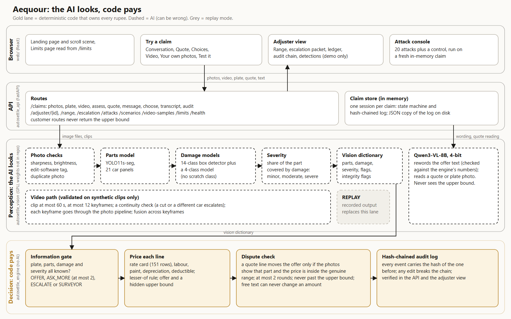
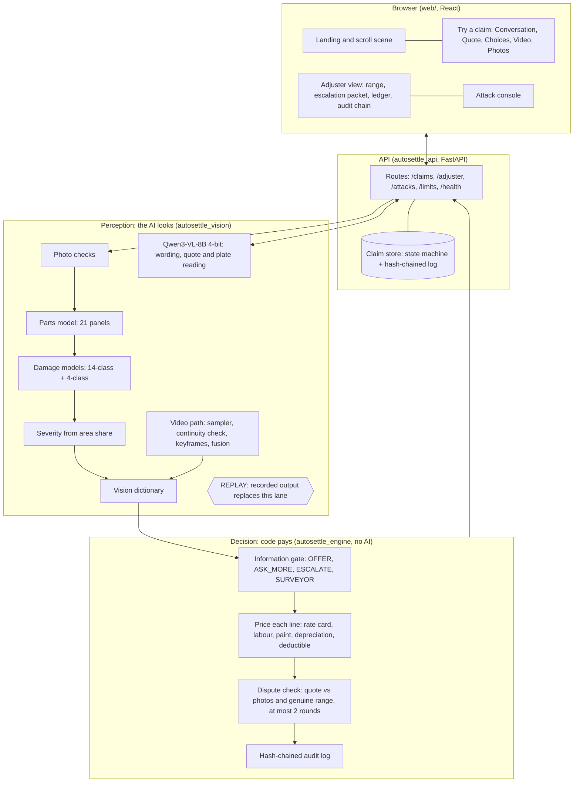

# Solution design

Design rule: **the AI perceives and talks; deterministic code decides every rupee.** Numbers below come from `docs/DECK_NUMBERS_FINAL.md` (each with source, sample and caveat) or from the code paths named. Thresholds are marked MEASURED (backed by a measurement we ran), RULE (an insurance rule used in our research, to verify) or ASSUMPTION (a team choice).

## 1. The problem and who it is for
The problem statement ("Auto-Settle AI: Autonomous Video-to-Cash Claims Adjuster") asks for a system that:
1. assesses vehicle damage from images or videos (component, damage type, severity);
2. estimates repair and settlement cost from a reference database, and establishes an allowable cash-settlement range;
3. presents an initial cash offer, responds to counteroffers, and settles without exceeding predefined limits;
4. applies guardrails and escalates uncertain or suspicious claims to a human, with a clear audit trail.

Users: a **customer** with a small claim who wants a fast, explained offer or a clear next step; a **claims adjuster** who receives only the claims the system cannot settle safely, with the evidence and reasons; and a **reviewer** who needs to see that no amount can be talked up or tampered with.

## 2. End-to-end flow
1. The customer opens a claim, types the number plate and sends photos (or a short video). The plate is matched to a simulated policy record (make, model, registration date, engine size, insured value).
2. **Perception** (`autosettle_vision`): photo checks (sharpness, brightness, editing-software tag, near-duplicate of a photo in another claim); a parts model outlines 21 car panels; a 14-class box detector and a 4-class model find damage; severity comes from the share of the panel the damage covers. For a video, a sampler picks at most 12 keyframes from at most 60 s, a continuity check flags a cut or a different car, and each keyframe goes through the same photo pipeline.
3. **Decision** (`autosettle_engine`): an information gate asks whether plate, panels, damage class and severity are all known. If not: ASK_MORE (at most twice, naming what is missing), then ESCALATE. Heavy or structural damage goes to a SURVEYOR. Otherwise each damaged panel is priced from the rate card (151 rows) plus labour and paint estimates, less depreciation and the compulsory deductible, giving an itemised **offer**. An internal **upper bound** is computed at the same time and never shown to the customer.
4. **Words**: the customer text is the engine's own derivation, written out. The language model may reword it; a checker blocks any reply that adds a figure, drops a line, names the bound or promises something, and the template is used instead.
5. **Conversation**: the customer can accept, send an itemised garage quote, repair at a partner garage, or ask for a surveyor. A quote line moves the offer only if the photos show that part and the price is inside the genuine range, at most twice, and never past the upper bound. Free text cannot change an amount; a figure named in a message gets a template answer that names the current offer and the routes that can move it.
6. **Outcome**: SETTLED (cash offer accepted), PARTNER_GARAGE, SURVEYOR, ESCALATED (a human), or STALL. Each is final; events after it are refused.
7. **Adjuster view** (demo only, no authentication claimed): the allowable range (offer, upper bound and which guardrail stops more), the escalation packet for ESCALATE and SURVEYOR claims, the assumption ledger, the detections table, and the audit chain with its verification result.

## 3. Architecture

Vector version: `architecture.svg`. Mermaid source (renders on GitHub):

## 4. Decision logic
Outcomes are decided by code from these inputs only. The full table with files and tests is `docs/GUARDRAILS.md`; the key rows:

| Condition | Outcome | Threshold | Basis |
|---|---|---|---|
| Any integrity flag (edit-software tag, near-duplicate photo, video not continuous) | ESCALATE | any flag; hash distance at most 4; 15 inliers | ASSUMPTION |
| Plate does not match the policy | ESCALATE | equality of the normalised plate | design rule |
| Heavy or structural damage suspected | SURVEYOR | 3 severe parts, or severe hood plus one more; severe roof, quarter or rocker panel | ASSUMPTION |
| Plate, panel, damage class or severity unknown | ASK_MORE, then ESCALATE after 2 requests | part confidence 0.50, damage confidence 0.30, 2 requests | ASSUMPTION |
| A severe call at low confidence | ESCALATE | below 0.50 | ASSUMPTION |
| A damaged part with no price basis | ESCALATE | any | design rule |
| Gross loss | SURVEYOR at ₹50,000 or more; at 75% of the insured value or more | | RULE (IRDAI surveyor regulations as used in our research); ASSUMPTION (75%) |
| Gross loss | ESCALATE at ₹40,000 or more | | ASSUMPTION |
| Otherwise | OFFER = gross repair cost less the deductible (₹1,000 up to 1,500 cc, else ₹2,000) | | RULE (deductible as used in our research) |
| Quote after an offer | offer moves only for lines supported by the photos and priced inside the genuine range; at most 2 quotes; never above the upper bound | 115% tolerance for "ok" | ASSUMPTION |

Pricing per damaged panel: `line = part_net + labour + paint_net`; `part_net = listed price less depreciation` (plastic 50%, glass 0%, metal by age) when the part is replaced; `paint_net = paint x (1 - 0.25 x 0.5)`; one detection per part; the cheaper of repair and replace for a dent (the lesser-of rule). Labour and paint ranges come from one garage's price list plus proxies (see `docs/ASSUMPTIONS.md`).

## 5. Data sources
- **Part prices:** `autosettle_engine/rate_card_v3.csv`, 151 rows of listed genuine-part prices with a source URL and a confidence tier; rows from aftermarket or partial-part listings are rejected and never price a claim.
- **Labour and paint:** one independent garage's panel-package price list (Delhi NCR, 5 Apr 2026) plus assumptions; estimated, not measured against a real garage.
- **Rules:** deductible, depreciation, paint-material rule and surveyor limit as used in our research (to verify).
- **Policies:** five simulated records (`autosettle_vision/policies.json`). No insurer lookup exists.
- **Models:** three YOLO models built from public datasets (no data of our own was collected; weights not distributed) and Qwen3-VL-8B-Instruct (4-bit). Versions and licences: `docs/TECH_STACK.md`.
- **Evaluation:** 41 public Wikimedia Commons dev photos labelled by Claude by eye, and 8 held-out photos run once.

## 6. Audit design
`ClaimSession` is a state machine (INTAKE, OFFERED, UPDATED_OFFER and the final states). Every event (claim created, photos added, submit, customer message, reply, dispute, choice, timeout) appends a record that carries the SHA-256 of the previous record. `verify_log` recomputes the chain; changing any entry breaks it. The chain is tamper-evident, not tamper-proof: whoever holds the entire log could recompute it. The API returns the chain and its verification result (`/claims/{id}/audit`), a conversation transcript tied to audit entries (`/claims/{id}/transcript`), and the adjuster view shows the result. A JSON copy of each log is written to disk.

## 7. What runs live and what is replayed
- **Always live:** the engine, the dispute logic, the audit chain, the rationale checker, the attack console, the API and the web app.
- **Live only with the weights and a GPU:** photo and video analysis, the language model (rewording, quote and plate reading).
- **Replay mode** (`--replay`): vision output recorded earlier from the real pipeline is served instead, for five scenarios (a protocol-compliant offer, a heavy crash to a surveyor, a prompt-injection attempt, a wide street photo that ends in a request for more, a counteroffer conversation) and two SYNTHETIC walk-around clips. Every response and the page say REPLAY. The engine runs live on that recorded input, so every rupee shown is computed at request time.
- **Demo photos** are public Commons photos kept outside the repository; number plates are blurred on the displayed copy only, and the pipeline reads the original.

## 8. Where it falls short
See `docs/GUARDRAILS.md` (Known limitations), `docs/FEATURE_COVERAGE.md` and the Limits page in the app: recall on hard photos (22 of 74 parts found), 8 silent misses, no scratch class, typed plates, synthetic-only video and quotes, no severity ground truth, estimated labour and paint.
